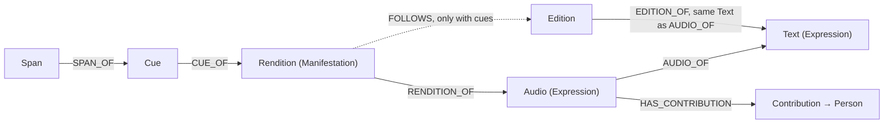

# Audio as its own Expression

Status: proposal, revision 2. Branch `feat/audio-expression-proposal`, up to date with `dev` (`8593529`). Issue: [#449](https://github.com/Webuddhist-tech/Webuddhist-library/issues/449).

Revision 2 adds two items from team review:

1. Cues and timings are already in `dev`. This proposal keeps them. It changes only the node that a cue attaches to.
2. The edition that a rendition follows must belong to the same text as the audio. The database must enforce this rule.

## Idea

- One artist's performance of a text is an **Audio** (Expression level).
- Each version of that performance (with music, without music) is a **rendition** (Manifestation level).
- A rendition with cues follows one written edition. That edition must be an edition of the same text as the Audio.
- A rendition without cues links only to the Audio.

## Example

```
Work: Heart Sutra
└─ Text (bo): Heart Sutra, Tibetan                ← written Expression
   ├─ Edition: critical                           ← written Manifestation
   └─ Audio (bo): Heart Sutra, sung by Artist A   ← audio Expression, AUDIO_OF the Tibetan text
      ├─ Rendition: without music                 ← has cues → FOLLOWS the critical edition
      └─ Rendition: with music                    ← no cues → links to the Audio only
```

A second artist gets a second Audio under the same Tibetan text.

## Graph


Editable source: [`audio-as-expression.excalidraw`](audio-as-expression.excalidraw) (open at excalidraw.com, File → Open). Mermaid source: [`audio-as-expression.mmd`](audio-as-expression.mmd).



| Level | Node | Holds |
|---|---|---|
| Expression | `Audio` | title, language, license, artist (contribution), `AUDIO_OF → Text` |
| Manifestation | `Rendition` | variant label (for example "with music"), audio file key, format, size, duration |
| Alignment | `Cue` + `Span` | `start_ms`, `end_ms`, and a `Span` in the `FOLLOWS` edition. No change from `dev`. |

## What is in `dev` now

The cue feature (`6d7dbb7`) is complete. We keep all of it.

| Item | Where | Status |
|---|---|---|
| Graph shape `(:Span)-[:SPAN_OF]->(:Cue {start_ms, end_ms})-[:CUE_OF]->(:Recording)` | `database/neo4j_schema.yaml`, `database/recording_database.py` | Keep. Change only the `CUE_OF` target if we rename `Recording`. |
| `GET`, `PUT`, `DELETE /v2/recordings/{id}/cues`. Cues are written and read in bulk. Cues have no ID. | `routers/recordings.py` | Keep. |
| Rules: one cue or more, `start_ms < end_ms`, sorted, no time overlap, gaps allowed, a span repeats for a refrain, span in edition content | `models/recording.py`, `RecordingDatabase.replace_cues` | Keep. |
| Triggers `enforce_cue_cue_of` and `enforce_cue_start_ms_lt_end_ms` | `database/neo4j_triggers.py` | Keep. |
| Cue spans move with `PATCH /v2/editions/{id}/content`. A cue is deleted when its full span is deleted. | `database/span_database.py` | Keep. Change the match path. |
| A cue write increments the edition revision | `touch_edition` in `replace_cues` and `delete_cues` | Keep. Use the `FOLLOWS` edition. |
| Content migration checks that cue spans are in range | `database/content_migration.py` | Keep. Change the match path. |

Today the cue span offsets point into the edition of `RECORDING_OF`. In this proposal they point into the edition of `FOLLOWS`. The offsets do not change. Existing cues stay correct after the migration.

## Rules

1. Every `Audio` must have exactly one `AUDIO_OF → Text`. You cannot change it after you create the Audio.
2. Every rendition must have exactly one `RENDITION_OF → Audio`.
3. A rendition can have zero or one `FOLLOWS → Edition`.
4. **Same text.** If a rendition has `FOLLOWS → Edition`, then that edition must have `EDITION_OF` the same `Text` as the Audio's `AUDIO_OF`. An edition of a translation or a commentary is not permitted.
5. A rendition can have cues only if it has `FOLLOWS`. All cue spans point into that edition.
6. If you change or remove `FOLLOWS`, the system deletes the cues of that rendition. Offsets into one edition are not correct in a different edition.
7. Contributions (the artist) are on the Audio only. All renditions of one Audio have the same artist. A different artist must have a different Audio.
8. If you delete an edition, the system deletes only the `FOLLOWS` relations and the cues that point into it. The Audio and its renditions stay.
9. The audio file key must not contain an edition ID. The rendition stores its key.

## Changes to make

| # | Change | Files |
|---|---|---|
| C1 | Add the `Audio` node with `AUDIO_OF → Text` (required), title, language, license, and narrator contributions. | `neo4j_schema.yaml`, new `models/audio.py`, new `database/audio_database.py` |
| C2 | Attach the rendition to the Audio with `RENDITION_OF` (required). Replace `RECORDING_OF → Edition` (required) with `FOLLOWS → Edition` (optional). Move title, language, license, and contributions from the rendition to the Audio. Add a variant label to the rendition. | `neo4j_schema.yaml`, `models/recording.py`, `recording_database.py` |
| C3 | Enforce the same-text rule (rule 4). Add a trigger with an audit query, as for `enforce_recording_contribution_narrator`. Also validate in the API and return `422`. | `neo4j_triggers.py`, `database_validator.py` |
| C4 | Enforce rule 5. Add a trigger: a `Cue` must belong to a rendition that has `FOLLOWS`. `PUT /cues` on a rendition with no `FOLLOWS` returns `422`. | `neo4j_triggers.py`, `recording_database.py` |
| C5 | Change the cue match path from `RECORDING_OF` to `FOLLOWS` in span updates, cue reads and writes, and content migration. | `span_database.py`, `recording_database.py`, `content_migration.py` |
| C6 | Edition delete: replace the cascade `RecordingDatabase.DELETE_ALL_QUERY` with a query that deletes only `FOLLOWS`, cues, and their spans. | `edition_database.py:200`, `recording_database.py` |
| C7 | Store the audio key on the rendition (`audio_key`), as `Edition.content_key` does. New key: `recordings/{rendition_id}.{format}`. Old files stay at their old keys. | `content_service.py:86`, `recording_database.py` |
| C8 | API. Add `POST` and `GET /v2/texts/{text_id}/audios`, and `GET`, `PATCH`, `DELETE /v2/audios/{id}`. Add `POST /v2/audios/{id}/renditions` (multipart). Add a way to set and remove `FOLLOWS`. Keep the cue endpoints. | `routers/`, `docs/api-documentation/recordings-api.md` |
| C9 | Migration. For each existing recording: make one Audio per (text, narrator set), attach the recording to it, change `RECORDING_OF` to `FOLLOWS`, and copy the old key into `audio_key`. Cues do not change. | new migration script |
| C10 | Tests: same-text rule, cues without `FOLLOWS`, edition delete keeps audio, migration. | `tests/test_recordings.py`, `tests/test_neo4j_triggers.py`, `tests/schema_contract.py` |

## Must keep (do not change these)

- `AUDIO_OF → Text` is required. Audio is an Expression, not a part of an edition.
- The same-text rule (rule 4). The database enforces it with a trigger, not only the API.
- Cue spans point into exactly one edition, the `FOLLOWS` edition. No cues without `FOLLOWS`.
- The current cue rules, the `Span` pattern, the bulk cue API, and the span updates on content edits.
- One Audio has one artist. The contributions are on the Audio.
- Edition delete never deletes audio.
- The audio file key does not depend on an edition.

## Options (the team can decide)

| Topic | Options | Recommendation |
|---|---|---|
| Name of the Manifestation node | Keep `Recording` and `/v2/recordings/...`, or rename to `Rendition` | Keep `Recording`. Clients and the cue endpoints already use it. Use `Rendition` only in documents. |
| License | On the Audio only, or a rendition can override it (a music track can have other rights) | Audio only now. Add an override later if necessary. |
| Variant label | Free text, or a fixed list (`with_music`, `without_music`) | Free localized text. |
| Old endpoint `POST /v2/editions/{id}/recordings` | Keep it as a shortcut that makes Audio + rendition + `FOLLOWS`, or remove it | Keep it for one release, then remove it. |
| Old S3 keys | Copy files to new keys, or keep old keys with `audio_key` | Keep old keys. Do not copy files. |
| Highlights in other editions through `ALIGNED_TO` segments | Now or later | Later. |
| Clean up audio files with no rendition | Now or later | Later. |

## Not in scope

- Audio of a translation. A Tibetan chant that follows an English edition is not permitted by rule 4. A translation read aloud gets its own Audio under the translation `Text`.
- Automatic cue generation from audio.
