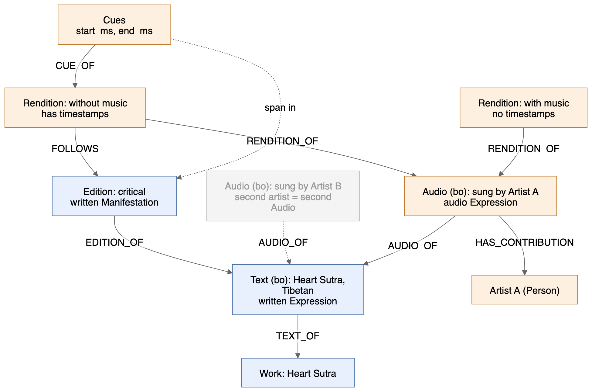
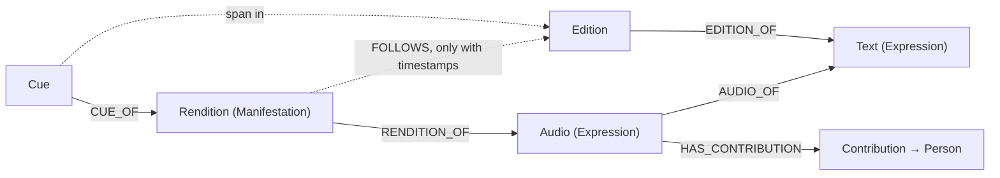

# Audio as its own Expression

Status: proposal. Branch `feat/audio-expression-proposal`, from `dev` (`939df17`).

## Idea

- One artist's performance of a text is an **audio Expression**.
- Each version of that performance (with music, without music) is a **rendition** at the Manifestation (edition) level.
- A rendition with timestamps is aligned to the written edition it follows. A rendition without timestamps is linked only at the Expression level.

## Example

```
Work: Heart Sutra
└─ Text (bo): Heart Sutra, Tibetan                ← written Expression
   ├─ Edition: critical                           ← written Manifestation
   └─ Audio (bo): Heart Sutra, sung by Artist A   ← audio Expression, AUDIO_OF the Tibetan text
      ├─ Rendition: without music                 ← has timestamps → aligned to the critical edition
      └─ Rendition: with music                    ← no timestamps → Expression-level link only
```

A second artist gets a second audio Expression under the same Tibetan text.

## Graph



Editable source: [`audio-as-expression.excalidraw`](audio-as-expression.excalidraw) (open at excalidraw.com, File → Open). Mermaid source: [`audio-as-expression.mmd`](audio-as-expression.mmd).



| Level | Node | Holds |
|---|---|---|
| Expression | `Audio` | title, language, license, artist (contribution), `AUDIO_OF → Text` |
| Manifestation | `Rendition` | variant label (e.g. "with music"), audio file, format, duration |
| Alignment | `Cue` | `start_ms`, `end_ms`, span in the `FOLLOWS` edition |

## Rules

1. Every `Audio` must have `AUDIO_OF` one `Text`. This is the Expression-level link and always exists.
2. Every `Rendition` must have `RENDITION_OF` one `Audio`.
3. `FOLLOWS → Edition` is optional. It is required only when the rendition has cues; all cues point into that edition.
4. Renditions of the same `Audio` share its artist; a different artist means a different `Audio`.
5. Deleting an edition removes `FOLLOWS` and its cues only. The audio and its renditions stay.

## Change from today

Today a `Recording` hangs off an edition (`RECORDING_OF → Edition`, required). Under this proposal the current `Recording` becomes a `Rendition`, and a new `Audio` node sits between it and the `Text`. Existing recordings migrate to one `Audio` per (text, artist) with one rendition each, plus `FOLLOWS` to their current edition.
