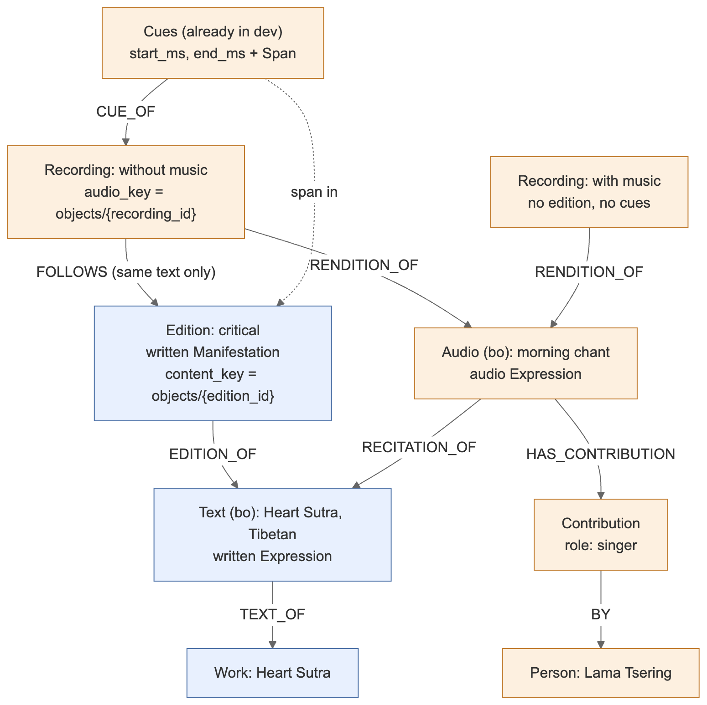

# Audio as its own Expression

Status: final design, implemented on branch `feat/audio-expression-proposal`. Design: [#449](https://github.com/WeBuddhist/Webuddhist-library/issues/449). Implementation: [#452](https://github.com/WeBuddhist/Webuddhist-library/issues/452).

## Idea

The original design below shows the storage layout at implementation time. New uploads now use
`base_texts/` for editions and `recordings/` for audio. See the [storage migration](../design/cutover.md#retire-the-objects-prefix).

- One performance of a text (one artist, one take) is an **Audio**. It is an Expression, at the same level as a Text.
- The Audio follows the **translation** pattern. It belongs to the same Work as the text it recites, and it names that text. It does not follow the commentary pattern (a new Work), because a recitation adds no new content.
- Each file of that performance (with music, without music) is a **Recording**. It is the Manifestation, like an Edition is of a Text.
- A Recording follows exactly one edition of the recited text. Cues point into that edition. The cue feature that is already in `dev` stays as it is.

## Graph

Both recordings now follow the written edition, including the version without cues. The sketch below shows the earlier design, when following an edition was optional. [Current relationship diagram](audio-as-expression.mmd)

[Editable original sketch](audio-as-expression.excalidraw)

| Level | Written (unchanged) | Audio |
|---|---|---|
| Work | `Work` | the same `Work` |
| Expression | `Text`: title, language, license, contributions. `TEXT_OF → Work`, `TRANSLATION_OF → Text` | `Audio`: title, language, license, date, contributions. `RECITATION_OF → Text` |
| Manifestation | `Edition`: file `content_key = objects/{edition_id}`, annotations | `Recording`: file `audio_key = objects/{recording_id}`, format, size, duration, version name, cues. `RENDITION_OF → Audio`, `FOLLOWS → Edition` |

Contributions on an Audio have the same shape as on a Text: `HAS_CONTRIBUTION → Contribution -[:WITH_ROLE]→ RoleType`, `-[:BY]→ Person | AI`. The audio roles are `narrator`, `singer` and `musician`.

## Rules

| # | Rule | Enforcement |
|---|---|---|
| R1 | An Audio belongs to the Work of the Text it recites. | Each Audio recites one Text through `RECITATION_OF`. Each Text identifies one Work through `TEXT_OF`. |
| R2 | The `FOLLOWS` edition is an edition of the recited Text. An edition of a translation or of another text is not permitted. | `422`. Trigger `enforce_recording_follows_recited_text`. |
| R3 | Every Recording must follow exactly one Edition at commit. | The upload requires `edition_id`. The schema requires one outgoing `FOLLOWS` relationship. |
| R4 | A client selects the edition when uploading the Recording. To choose another edition, delete the Recording and upload a new one. | The upload accepts `edition_id`. The API provides no edition update operation. |
| R5 | A following Recording blocks deletion of its Edition, even before cues are added. | `409`. |
| R6 | A Text cannot be deleted while an Audio recites it. | `409`. |
| R7 | An Audio cannot be deleted while it has Recordings. | `409`. |
| R8 | IDs come from `generate_id()`. New files go to `objects/{recording_id}`, saved as `audio_key`. Existing files keep their key. | API. |

An Audio needs only its Text. Clients must choose an edition for each Recording at upload.

## Endpoints

| Method | Path | Purpose |
|---|---|---|
| `POST`, `GET` | `/v2/texts/{text_id}/audios` | Create an Audio for a text; list the Audios of a text |
| `GET`, `PATCH`, `DELETE` | `/v2/audios/{audio_id}` | One Audio. The recited text cannot change. |
| `POST`, `GET` | `/v2/audios/{audio_id}/recordings` | Upload a Recording (multipart, required `edition_id`); list Recordings |
| `GET`, `PATCH`, `DELETE` | `/v2/recordings/{recording_id}` | One Recording (version name, duration) |
| `GET`, `PUT`, `DELETE` | `/v2/recordings/{recording_id}/cues` | Unchanged |
| `GET` | `/v2/editions/{edition_id}/recordings` | The Recordings that follow an edition |

`POST /v2/editions/{edition_id}/recordings` is removed. Details: [audios-api.md](../api-documentation/audios-api.md), [recordings-api.md](../api-documentation/recordings-api.md).

## Existing recordings

`python -m scripts.migrate --apply` converts each recording that is attached to an edition, with the API stopped, before the release starts:

- A new Audio recites the edition's text and belongs to its Work. Title, language, license, date and contributions move to it. A missing language becomes the text's language; a missing license becomes `public`.
- The Recording follows the same edition, keeps its cues, and records its existing file key in `audio_key`. No file is copied.
- All recordings convert in one transaction. Later runs find nothing to convert.

The conversion runs after the new triggers are live, because the triggers they replace reject a Recording without `RECORDING_OF`. See [cutover.md](../design/cutover.md).

## Not in scope

- Moving existing files to the new key pattern.
- Restricting the roles a Text accepts. Texts accept every role today, `narrator` included.
- Highlights in other editions through `ALIGNED_TO` segments.
- Cleanup of audio files that no Recording references.
- Automatic cue generation from audio.
