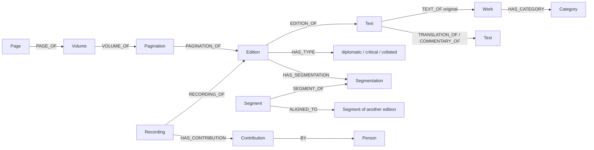
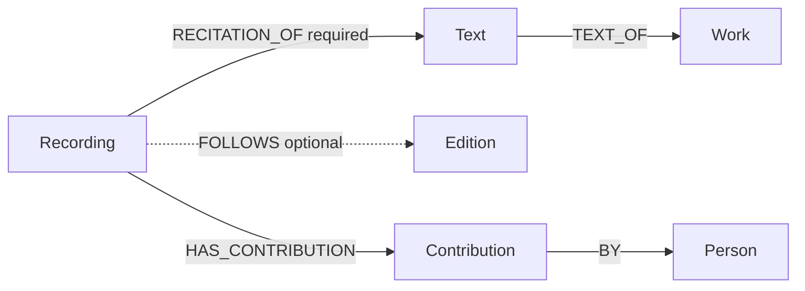
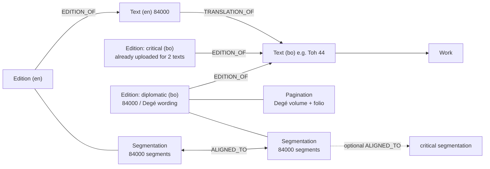

# Audio recordings, artists, and 84000 ingestion: gap analysis

Branch: `dev` (HEAD `523dc68`). We compared the code with the live API at library.webuddhist.com on 2026-10-23.

This document gives answers to three questions:

1. Is the current audio model correct for our WEMI graph? If it is not correct, what must we change?
2. Where must we keep the reciter ("artist") data: in the library or in the WeBuddhist app backend?
3. Can we load the 84000 texts with the current endpoints? What is missing?

Each finding shows the file that it comes from. Each proposal is the smallest change that fixes the problem. The "Deferred" section shows items that we do not propose now.

---

## 0. The graph at this time



| WEMI level | Our node | Notes |
|---|---|---|
| Work | `Work` | It has only a category and tags. The titles are on `Text`. |
| Expression | `Text` | It has a language, contributors (author or translator), and a license. A `Text` → `Text` relation shows a translation or a commentary. |
| Manifestation | `Edition` | The type is diplomatic, critical, or collated. The content is in S3. The annotations connect to the edition. |
| Item | S3 object | `base_texts/{text_id}/{edition_id}.txt` |
| (audio) | `Recording` | It connects to an edition with `RECORDING_OF`. The audio file is in S3 at `recordings/{edition_id}/{recording_id}.{ext}`. |

Source: `database/neo4j_schema.yaml`, `storage/s3.py:34,94`.

---

## 1. Audio: is the current model correct?

> **Superseded.** The audio model in this section is replaced by [audio-as-expression.md](audio-as-expression.md) (issue [#449](https://github.com/Webuddhist-tech/Webuddhist-library/issues/449)). Use that document for the audio model, the cue rules, and the work steps. The findings A1 to A5 stay correct.

### Current endpoints and data

- `POST /v2/editions/{edition_id}/recordings` uploads the audio file and the JSON metadata in one multipart request (`routers/editions.py:355`).
- `routers/recordings.py` has these endpoints:
  - `GET /v2/editions/{edition_id}/recordings`
  - `GET`, `PATCH`, and `DELETE /v2/recordings/{id}`
  - `GET /v2/recordings/{id}/audio`. This endpoint sends a 307 redirect to a presigned URL.
- A `Recording` has these properties: title, language, license, date, duration_ms, format, size_bytes, and contributions.
- Each contribution must have the role `narrator` (`models/recording.py`, trigger `enforce_recording_contribution_narrator`).
- The live API has all of these endpoints.

### Result: the data is correct, but the recording connects to the wrong node

A recitation has its own language, license, date, and contributors. This is correct. In WEMI, this makes the recitation an **Expression**. A recitation is a spoken or sung form of the work. A translation is a written form of the work.

The problem is the node that the recording connects to. At this time, a recording connects to a **Manifestation** (`RECORDING_OF → Edition`). This relation is required, and a recording can have only one. Thus the graph says: "This audio is a part of edition X." The correct meaning is: "This audio is a recitation of text T. The reciter used the words of edition X."

This causes these problems:

| # | Problem | Location | Result |
|---|---|---|---|
| A1 | You cannot add an audio file before you upload a written edition. | `CREATE_QUERY` uses `MATCH (m:Edition …)`. The schema has `required: true`. | We cannot add the chant of a reciter before its text is in the library. |
| A2 | When you delete an edition, the system also deletes all of its recordings. It does not tell you. The audio files stay in S3. | `edition_database.py:193` calls `RecordingDatabase.delete_all_with_transaction`. `routers/editions.py:430` does not call `storage.delete_recording`. | We lose data, and S3 keeps unused files. If you replace a critical edition, you lose all of its audio. |
| A3 | The storage key contains the `edition_id`. | `storage/s3.py:94` | If you move a recording to a different edition, the system cannot find its file. |
| A4 | You can get a list of recordings only for one edition. | There is no `GET /v2/recordings` endpoint. | The app cannot show all recitations of a text, all recordings of an artist, or all Tibetan chants. |
| A5 | There is no link between the audio time and the text segments. | This feature does not exist. | The library cannot supply data for follow-along highlights or for group recitation in unison. |

A5 is a missing feature. It is not an error in the model. A1 to A4 occur because the recording connects to the edition.

### Proposed change

Connect the recording to the Text. Keep a link to the edition, but make it optional:



- **`(:Recording)-[:RECITATION_OF]->(:Text)`** is required.
  - With this relation, the recording is an Expression next to the Text. You can find the Work through the Text.
  - We do not connect the recording directly to `Work` for two reasons. First, `Work` has no title and no language. Second, we must know if the reciter used the English 84000 translation or the Tibetan original.
- **`(:Recording)-[:FOLLOWS]->(:Edition)`** is optional.
  - It shows which words and which segmentation the reciter used.
  - It is necessary only when the recording has segment timings (A5).
- **Storage key:** change it to `recordings/{recording_id}.{ext}`. This fixes A3.
- **Edition delete:** remove only the `FOLLOWS` relation and the timings. Keep the recording. This fixes A2.
- **Endpoints:**
  - Add `POST /v2/texts/{text_id}/recordings`. This is the primary endpoint to make a recording. It is a multipart request. The metadata can contain an optional `follows_edition_id`.
  - Keep `POST /v2/editions/{edition_id}/recordings`. This endpoint must make the two relations. Thus the current clients continue to work.
  - Add `GET /v2/recordings?text_id=&person_id=&language=&limit=&offset=`. This fixes A4.
- **Migration:**
  - Use one Cypher query to change each `RECORDING_OF` relation. Each one becomes a `RECITATION_OF` relation to the text of the edition, plus a `FOLLOWS` relation to the edition.
  - Copy each S3 object to its new key.
  - There are few recordings at this time. Thus the migration is easy now.

In this proposal, one `Recording` node is both the Expression and the Manifestation. We do this to keep the model simple. The "Deferred" section tells when to make two nodes.

### Segment timings (A5): necessary if the app shows follow-along

> **Superseded.** Do not add a `Timing` node. Cues already exist in `dev` (`(:Span)-[:SPAN_OF]->(:Cue)-[:CUE_OF]->(:Recording)`, `/v2/recordings/{id}/cues`), and their spans move with content edits. See "What is in `dev` now" in [audio-as-expression.md](audio-as-expression.md).

This endpoint uses the same pattern as other annotations: one set for each parent.

```
PUT /v2/recordings/{recording_id}/timings
{ "timings": [ { "segment_reference": "1.1", "start_ms": 0, "end_ms": 4200 }, ... ] }
```

- The system finds each reference in the segmentation of the `FOLLOWS` edition. It uses the same check as `AlignmentDatabase._validate_segment_references`.
- The graph keeps each timing as `(:Timing {start_ms, end_ms})-[:TIMING_OF]->(:Recording)` and `-[:AT]->(:Segment)`. Another possible model is a property map on the relation.
- `PATCH /v2/editions/{id}/content` can make the timings incorrect. A new segmentation can also make them incorrect. In the first version, delete the timings when the system deletes the segmentation that they use. Write this rule in the API documentation.

---

## 2. Artists: library or app backend?

**Answer: keep the artist data in the library. The library already supports it.**

- A reciter is a `Person`. For text-to-speech, the reciter is an `AI`.
- The `Recording` gives credit to the reciter with `Contribution{role: narrator}`. (In [audio-as-expression.md](audio-as-expression.md), the contribution moves to the `Audio` node.) A `Text` gives credit to authors and translators in the same way.
- We examined the WeBuddhist app backend (`main` and `audio_track_clean_v2`). It has no artist model. Its audio code is for audio that users upload and for text-to-speech in plans. That is a different function.

Divide the data as follows:

| Library (primary data, used by all apps) | App backend (display and social data) |
|---|---|
| Person ID, names in each language, BDRC and wiki IDs | Profile photo, short biography, banner |
| The recordings of the person (`Contribution` on `Recording`) | Follows, likes, play counts |
| The role of the person on each recording | The practice spaces that show the person |

The app keeps the library `person_id` as a foreign key. The app must not copy the names.

Gaps:

| # | Gap | Fix |
|---|---|---|
| P1 | There is no query for the recordings of one person. | Use the `GET /v2/recordings?person_id=` endpoint from A4. |
| P2 | The word `narrator` is usual for audiobooks. A chant has a leader (umdze) and an assembly. | Use `narrator` at this time. Add more roles only when the app shows them separately. |
| P3 | You must enter a group (for example, a monastery assembly) as a `Person`. | This is satisfactory at this time, because a `Person` needs only a name. Examine this again if we must show the members of a group. |

---

## 3. 84000 texts: what is necessary and what exists

### Data model for each text (approximately 100 texts)



### Procedure with the dev API

| Step | Endpoint | Status |
|---|---|---|
| 1. Find the Tibetan text that already exists (2 of approximately 100). | `GET /v2/texts?bdrc=` or `?title=` | ✅ Exists. |
| 2. Make the Tibetan text for the other approximately 98 texts. | `POST /v2/texts` | ✅ Exists. ⚠️ The `enforce_text_title_unique` trigger stops a second text with the same title and language. Thus a second run must find the text first. |
| 3. Make the diplomatic edition with its pagination. | `POST /v2/texts/{id}/editions` with `pagination` | ⚠️ This works, but D1 and D2 (below) are problems. |
| 4. Add the 84000 segmentation to the diplomatic edition. | `POST /v2/editions/{id}/segmentation` | ⚠️ This works only as a second request (D1). |
| 5. Add the pagination later, if step 3 did not send it. | `POST /v2/editions/{id}/pagination` | ✅ Exists. An edition can have only one pagination. A second pagination gives a 409 error. The trigger for diplomatic editions requires the pagination in step 3. |
| 6. Make the English text. Set `translation_of` to the Tibetan text. | `POST /v2/texts` | ✅ Exists. Use the license `cc-by-nc-nd` (the 84000 license). Add the translator contributions. |
| 7. Make the English edition with its segmentation. | `POST /v2/texts/{en_id}/editions`, type `critical` | ✅ This works. ⚠️ See the name problem D3. |
| 8. Align the English edition with the Tibetan diplomatic edition. | `PUT /v2/editions/{en_ed}/alignments/{bo_dipl_ed}` | ✅ Exists. It checks the references on the two sides. |
| 9. (Optional) Align the diplomatic edition with the critical edition. | The same endpoint | ✅ Exists. If you do not do this step, you can find the English only from the diplomatic edition. The app shows the critical edition at this time. |
| 10. Add the tag for the practice space. | `POST /v2/texts/{text_id}/tags/{tag_id}` | ✅ Exists. Each tag belongs to an `Application`. |

**Do we have the endpoints?** Yes. The dev branch and the live API have an endpoint for each item:

- diplomatic edition
- pagination as a separate annotation
- segmentation
- translation text
- alignment between two editions

Two rules cause problems: one validation rule and one identifier rule (see below). We also need a loader script. The script is not an endpoint. It sends approximately 10 requests for each of the 100 texts.

### Problems and incorrect rules

| # | Problem | Location | Why it is incorrect | Fix |
|---|---|---|---|---|
| **D1** | A diplomatic edition cannot have a segmentation when you make it. A critical edition cannot have a pagination. | `models/requests.py` `validate_annotation` | Pagination and segmentation are two independent annotations. Pages show the physical layout. Segments show the meaning. The rule is also not consistent: `POST /editions/{id}/segmentation` accepts a segmentation on a diplomatic edition after you make it. Thus the 84000 load needs two separate requests for each text. If the second request fails, the edition has no segments. | Keep the rule "a diplomatic edition must have a pagination". A trigger also checks this rule. Keep the rule "a critical edition must have a segmentation". Remove the two "must not" rules. This is a change to one function, plus tests. |
| **D2** | A diplomatic edition must have a `bdrc` value. Each `Edition.bdrc` value must be unique in the database. | `models/edition.py` `validate_edition`, `neo4j_constraints.cypher` `edition_bdrc_unique` | The 84000 Tibetan text comes from the Degé Kangyur (BDRC `W22084`). If we use the ID of the collection, all 100 editions have the same value, and the unique constraint stops the load. If we use one BDRC ID for each text, we must have that ID for each Toh number. | **You must make a decision.** Option (a): supply one BDRC instance ID for each Toh number. Option (b): make `bdrc` optional for diplomatic editions that have a `source`. Write "84000" or "Degé" in `source`, and put the Toh and folio references in the pagination. Option (b) is the smaller change. |
| D3 | The English 84000 edition must have the type `critical` to have a segmentation. | `EditionType` | This edition is not a critical edition in the philological meaning. It is the only edition of the translation. This problem does not stop the load. | Accept this at this time. Write in the documentation that "critical" means "the primary reading edition of this Text". Change the name only if it causes confusion. |
| D4 | Only the diplomatic edition has the 84000 segmentation. The app shows the critical edition. | Traversal with `ALIGNED_TO` (see commit `523dc68`) | A search for related segments from the critical edition finds the English only if the diplomatic and critical editions are aligned. | Option 1: show the diplomatic edition directly in the 84000 practice space. This is the simplest option. Option 2: do step 9. |
| D5 | There is no bulk import that you can safely run again. | None | A second run makes duplicate editions. A trigger stops duplicate titles, but nothing stops duplicate editions. | The loader script must first find the records that exist. It can use a Toh number in `Edition.source`, or the BDRC ID. This is a change in the script, not in the API. |

### Decisions necessary before the work starts

1. **D2:** Do we use one BDRC ID for each text? Or do we make `bdrc` optional for diplomatic editions that have a `source`?
2. **D4:** Does the 84000 space show the diplomatic edition directly? Or do we also align the diplomatic edition with the critical edition for the 2 texts that we already have?
3. **A5:** Must the first release of the app show follow-along (segment timings) for the 84000 group recitation?

---

## 4. Sequence of the work

| # | Change | Test |
|---|---|---|
| 1 | D1: remove the "must not" rules in `EditionRequestModel.validate_annotation`. | A test makes a diplomatic edition with a pagination and a segmentation in one request. The current test for a critical edition without a segmentation must continue to fail. |
| 2 | D2: do the change that you select. | A test makes two diplomatic editions from the same source. The `bdrc` constraint must not stop the second edition. |
| 3 | ~~A2: delete the S3 audio files when the system deletes an edition.~~ **Superseded.** Edition delete must not delete recordings or audio files. See rule 8 and C6 in [audio-as-expression.md](audio-as-expression.md). | A test makes sure that an edition delete keeps the recordings and their files. |
| 4 | A1, A3, A4: **superseded.** Do C1 to C9 in [audio-as-expression.md](audio-as-expression.md) (Audio node, `AUDIO_OF → Text`, `FOLLOWS`, same-text rule, storage key, migration). | The recording tests pass with the new endpoint. The old edition endpoint continues to work. The migration audit query finds 0 orphan recordings. |
| 5 | A5: **superseded.** Cues already exist in `dev`. Keep them and change only their match path (C4, C5 in [audio-as-expression.md](audio-as-expression.md)). | A `PUT` with an unknown reference gives a 422 error. A `GET` gives the timings in the sequence of `start_ms`. |
| 6 | Write the 84000 loader script. The script is not a part of the API. | Do a test run on the 2 texts that we already have. The script must make only the new diplomatic edition, the English text and edition, and the alignment. A second run must not make duplicates. |

Steps 1 to 3 are small, and you can do them in any sequence. Only step 4 changes the schema.

## Deferred (we do not propose these items now)

- **Make two nodes from `Recording`: an audio Expression and one or more Manifestations.** (Now proposed in [audio-as-expression.md](audio-as-expression.md).) Do this only when one performance has more than one master (for example, a remaster, a different mix, or an excerpt). Different file formats of the same master do not need this change, because each file format is an Item.
- **Separate roles for the chant leader and the assembly, and a group entity.** Add these when the app shows them separately.
- **A new name for `EditionType.critical`.** See D3.
