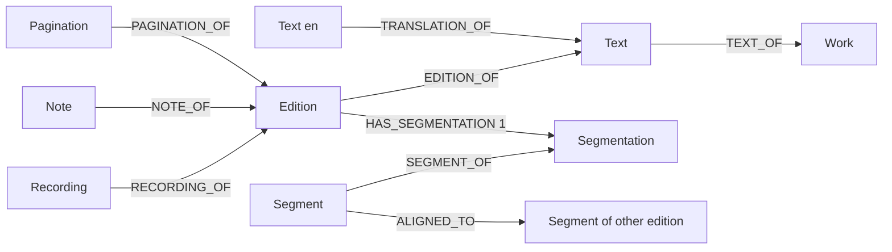
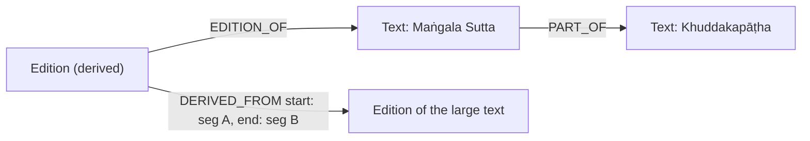
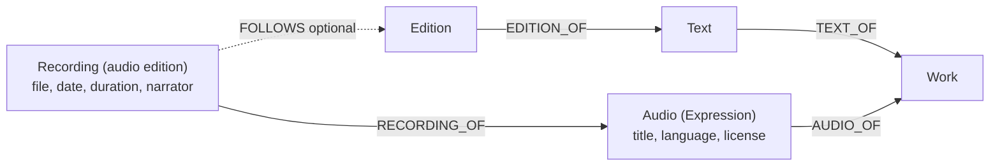
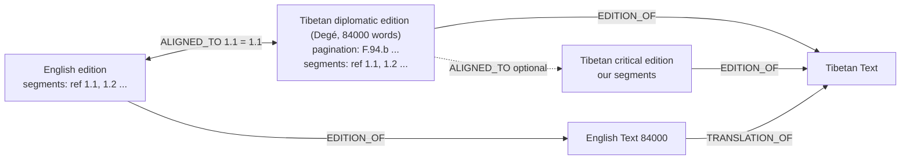

# New requirements: text sections, audio, 84000 segment IDs, footnotes

Status: draft for team discussion. Branch `dev` (HEAD `523dc68`), 2026-10-26.

This document has four requirements. For each requirement, it gives:

- the problem,
- what the library has now and what it does not have,
- what is necessary,
- the proposed solution and the decisions for the team.

Related document: [audio-recordings-and-84000-ingestion.md](audio-recordings-and-84000-ingestion.md). It has the full audio and 84000 gap analysis. This document does not repeat it.

## Current model (short)

- `Work` has the category and the tags. `Text` has the title, language, license, and contributors.
- `Edition` has the content (in S3) and the annotations.
- An edition has a maximum of one segmentation and one pagination.
- Each segment can have a `reference` (for example `1.1`). The reference is unique in its segmentation. Alignments use these references.
- When you edit the content, the system moves the spans of all annotations (`docs/text-operations-spec.md`).

---

## 1. A section of a large text as its own text

### Problem

- We upload the full Tipiṭaka from tipitaka.app as large texts.
- Communities (for example, Theravāda practice spaces) want one small part only, for example one sutta.
- At this time, we upload the small part again as a separate text. Thus the same words are in two places. If we correct one copy, the other copy stays incorrect.
- The section must have its own title, author or translator, category, and tags.

### Available now

| Item | Location |
|---|---|
| Get part of the content by character position | `GET /v2/editions/{id}/content?span_start=&span_end=` |
| Section titles with spans | Table of contents annotation |
| Segments with references | Segmentation annotation |

### Not available

- A section has no ID, title, contributors, category, or tags. It is not in the text list.
- A section cannot have a translation, a commentary, or a recording.
- The annotations of the section (segments, notes, pages) are not available with positions that start at 0.

### Necessary

1. Keep the words only one time, in the large edition.
2. Give the section its own catalog data (title, contributors, category, tags).
3. Get the content and the annotations of the section through the API.

### Proposed solution: section text with a derived edition

- The section is a usual `Text`. It has its own `Work`, title, contributors, category, and tags. It is in `GET /v2/texts`.
- `(:Text)-[:PART_OF]->(:Text)` shows the large text.
- The section has one edition with no content in S3. `DERIVED_FROM` points to the large edition. It keeps the first and the last segment of the section, not character positions.
  - Reason: segments move correctly when somebody edits the content. Stored character positions do not move.
- The current edition endpoints operate on the derived edition:
  - `GET /v2/editions/{id}/content` gets the words from the large edition.
  - `GET /v2/editions/{id}/segmentation` (and the other annotations) gives only the annotations in the section. The positions start at 0.
- The derived edition is read-only. To correct the words, edit the large edition. The section then shows the correction.
- A translation of the section can use `TRANSLATION_OF` to the section text, as usual.
- New endpoint: `POST /v2/texts/{text_id}/sections` with the catalog data and `{edition_id, start_segment_id, end_segment_id}`.

### Other options

| Option | Why we do not recommend it |
|---|---|
| Add catalog data to the table of contents section | A ToC section is not a text. It cannot have a translation, tags, or a recording. It is not in the text list. |
| Keep a copy of the words (current method) | Two copies of the same words. This is the maintenance problem. |
| Keep character positions on the section | The positions become incorrect when somebody edits the large edition. |

### Decisions for the team

1. Does a section always have its own `Work`? Or can it share the `Work` of the large text?
2. Can a section use the table of contents section as its boundary (instead of two segments)?
3. What occurs to a section when somebody deletes the large edition? Proposal: the API stops the delete (409) while sections use the edition.

---

## 2. Audio

### Problem

- We will upload more than one audio file for each text.
- At this time, a recording connects to an edition (`RECORDING_OF`). When you delete the edition, the system also deletes all its recordings. The audio files stay in S3.
- You cannot add audio before there is a text edition.

### Available now

- Upload, get, change, delete a recording. Get a list of recordings for one edition.
- A recording has title, language, license, date, duration, format, and narrator contributions.
- The reciter is a `Person`.

### Not available

- A recording that does not depend on an edition.
- A list of recordings by text, person, or language.
- A link from audio time to text segments (follow-along).

### Necessary

1. A deleted edition must not delete audio.
2. Audio must connect to the work, at the same level as a text.
3. One audio can have more than one edition (performance or file). Each audio edition can point to the text edition that the reciter read.

### Proposed solution (your suggestion, with small changes)

- `Audio` is a new node, at the same level as `Text`. It connects to `Work`. It has its own title, language, and license.
  - Example: "Heart Sūtra, Tibetan chant".
- `Recording` becomes the audio edition. It connects to `Audio`. It has the file, the date, the duration, and the reciters.
  - Example: "Heart Sūtra, Tibetan chant, Sera Jey assembly, 2024".
- `FOLLOWS` is optional. It points to the text edition that the reciter read. Segment timings (follow-along) use this edition.
- When you delete an edition, the system deletes only `FOLLOWS` and the timings. The recording stays.
- Storage key: `recordings/{recording_id}.{ext}`. It does not contain the edition ID.
- Endpoints:
  - `POST /v2/texts/{text_id}/audios`: makes an `Audio` on the `Work` of that text. (The API does not show `Work` IDs at this time.)
  - `POST /v2/audios/{audio_id}/recordings`: uploads one audio edition.
  - `GET /v2/recordings?text_id=&person_id=&language=`
  - Keep `POST /v2/editions/{edition_id}/recordings` for current clients. It makes the `Audio`, the `Recording`, and `FOLLOWS`.

The other document recommended a smaller model: `Recording` connects directly to `Text`, with no `Audio` node. Your model is better if one chant has many performances that the app shows as one group. It also has the same pattern as `Text` → `Edition`.

### Decisions for the team

1. Do we need the `Audio` group node? Or is "one recording connects to one text" sufficient?
2. Is follow-along (segment timings) necessary in the first release?
3. Migration: there are few recordings now. Do we migrate them now, before more uploads?

---

## 3. 84000 translations and their segment IDs

### Problem

- We have the Heart Sūtra as a critical edition with our own segments.
- The 84000 English translation aligns with the 84000 Tibetan text. That text is a diplomatic text of the Degé Kangyur. Its segments are different from our segments.
- The 84000 Tibetan text has folio references (for example `F.94.b`). It also has a segment ID after each segment (for example `1.1`, `1.2`). The English translation has the same IDs.
- Users know the 84000 IDs. We must keep them.
- Question: where do we keep the segment IDs? In the pagination? In a new annotation? Only on the English side?

### Available now

| 84000 data | Library place | Status |
|---|---|---|
| Degé Tibetan words | Diplomatic edition of the Tibetan text | ✅ |
| Folio (`F.94.b`) | Pagination annotation (volume, page `reference`) | ✅ |
| Segment ID (`1.1`) | `Segment.reference` in the segmentation | ✅ The field exists. It is unique in the segmentation. |
| English to Tibetan link | Alignment, by segment reference | ✅ |
| Chapter headings | Table of contents annotation | ✅ |
| Translator notes | No footnote type | ❌ See section 4 |

### Not available or incorrect

- **D1:** A diplomatic edition cannot have a segmentation when you make it. You must add it with a second request.
- **D2:** A diplomatic edition must have a unique `bdrc` value. All 84000 texts come from one collection (Degé, `W22084`).
- **D4:** The app shows the critical edition. The English translation connects only to the diplomatic edition.

### Answer: the segment ID is a segment reference, not a page

- Pagination shows the **physical** place (volume, folio). A segment ID shows a **unit of meaning**. These are two different things. Do not add segment IDs to the pagination.
- We do not need a new annotation. The segmentation already has `reference` for each segment.
- Do not put the 84000 IDs on our critical edition. An edition has only one segmentation, and our critical segments are different.

### Proposed solution

1. Upload the Tibetan text as a **diplomatic edition** with the Degé pagination and the 84000 segmentation. Each segment `reference` is the 84000 ID.
2. Upload the English text as a translation. Its segmentation has the same references.
3. Align English to the diplomatic edition. Each pair is `1.1` ↔ `1.1`.
4. Optional: align the diplomatic edition to our critical edition. Then the app can find the English from the critical edition.
5. Put the 84000 notes in footnote annotations (section 4).

Fixes necessary before the load: D1 (remove the "must not" rules) and D2 (see the decision below).

### Decisions for the team

1. D2: one BDRC ID for each Toh number, or make `bdrc` optional when `source` is "84000"?
2. D4: does the 84000 space show the diplomatic edition directly? Or do we align it to the critical edition?
3. Must the app show the segment reference (`1.1`) to the reader, as 84000 does?

---

## 4. Footnotes

### Problem

- Much of the new data has footnotes: 84000 translator notes, Tipiṭaka notes, and notes in printed books.
- The library has no footnote annotation.

### Available now

- The `Note` node with a `NoteType`. Only one type exists: `durchen` (variant readings).
- A note has a span and a text. A span can be empty (`start = end`). An empty span marks a position. This is correct for a footnote marker.
- When somebody edits the content, the system moves the note spans.

### Not available

- A `footnote` note type and its endpoints.
- The marker label as printed (for example `12` or `n.12`).

### Necessary

1. Keep footnotes separate from durchen. A durchen is a variant reading from collation. A footnote is a note from the author, translator, or editor.
2. Keep the footnote marker label, so we can show the same number as the source.

### Proposed solution

- Add `footnote` to `NoteType` (enum, schema, trigger). Use the current `Note` node.
- Add an optional `label` field to `Note` (for example `n.12`).
- Endpoints, same pattern as durchen:
  - `GET` and `POST /v2/editions/{edition_id}/footnotes`
  - `GET` and `DELETE /v2/footnotes/{footnote_id}`
- Span: an empty span at the marker, or the span of the words that the note explains.
- This is a small change. It does not change the graph structure.

### Decisions for the team

1. Is the note text plain text, or do we allow simple formatting (italic, links)?
2. Can a footnote have more than one language? At this time, `Note.text` is one string.

---

## Summary and sequence

| # | Change | Size | Schema change |
|---|---|---|---|
| 1 | Footnote note type and endpoints | Small | New enum value, new optional field |
| 2 | D1 and D2 fixes for the 84000 load | Small | D2 only, if `bdrc` becomes optional |
| 3 | 84000 loader script (diplomatic + English + alignment) | Medium | No |
| 4 | Audio: `Audio` node, `Recording` as audio edition, `FOLLOWS`, migration | Medium | Yes |
| 5 | Section texts with derived editions | Medium to large | Yes |

Items 1 and 2 are necessary for item 3. Items 4 and 5 are independent.
